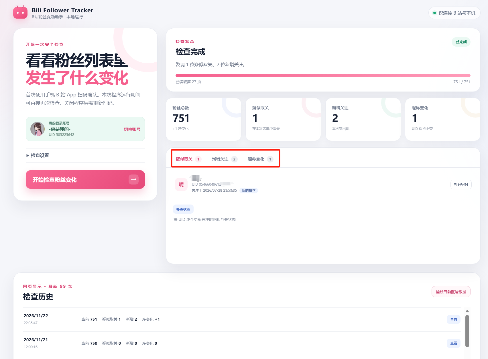
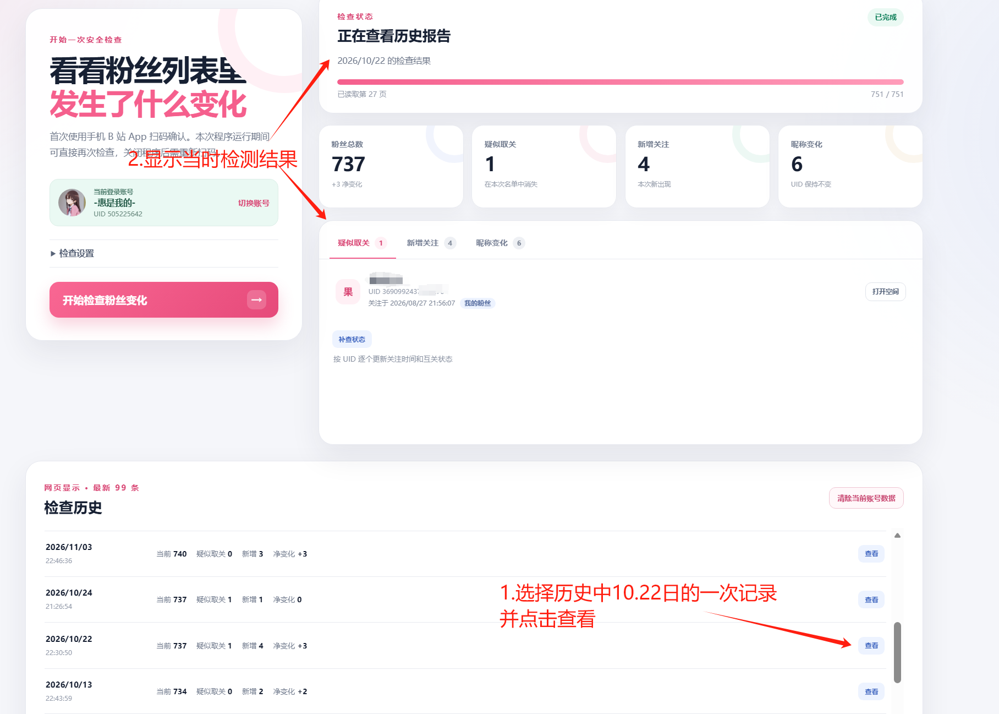
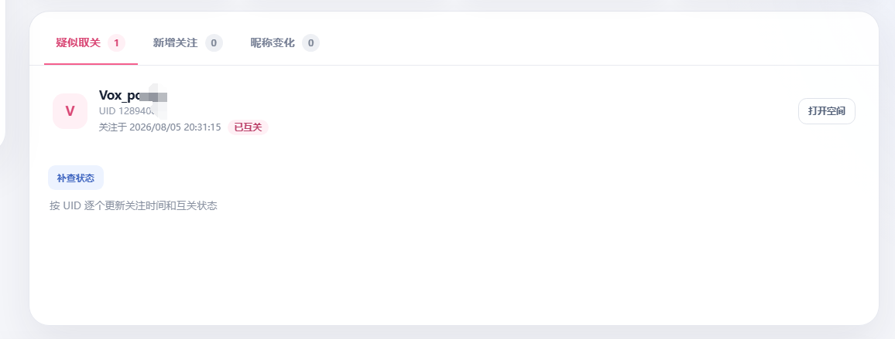

# Bili Follower Tracker

**B站粉丝变动助手**

作为一个b站小up，在看到粉丝数停滞不前还偶尔下跌时，总是会难受地不行，不停下滑翻找粉丝列表，想看看到底是谁取关了啊啊啊————但毕竟肉眼凡胎，不可能记住所有的粉丝以及一大串uid，于是便有了这个小程序，可以帮助你查看是谁取关了自己（另外，还要叠甲一下，关注与取关当然是每个人的权力了，不再喜欢或者觉得做的东西没意思被打扰了也是理所应当取关的，本工具只是用于帮助up主进行粉丝管理和分析，不强迫或骚扰取关的用户强行关注~）

这个小工具会定期保存你的粉丝名单，并比较前后两次记录，帮助你找出：

- 哪些账号疑似取关；
- 哪些账号刚刚关注；
- 哪些粉丝修改了昵称；
- 粉丝的关注时间和检查时的互关状态。

程序在你自己的电脑上运行，数据也保存在程序文件夹里，它不是 B 站官方工具，也不是时光机——开始记录之前发生的取关，无法凭空找回。

> [!CAUTION]
> 本项目为非官方工具，接口可用性、账号状态和检测结果均存在不确定性。使用前请阅读下方的[免责声明与风险提示](#免责声明与风险提示)，妥善保护登录凭证和粉丝数据。

## 技术支持

本项目由B站用户**星沃**提供技术支持。

## v0.4 系列更新亮点

通常访问的B站的**粉丝接口**，只能获取最近1000名的粉丝信息，这对许多粉丝数较多的up主来说，先前版本的此程序仅能获取到1000粉的名单并比较他们的变化，将会是个明显的硬伤。而现在，通过B站的**通讯录接口**(B站APP首页->右上角私信->右上角三点->通讯录)则可以查看并获取全量的粉丝信息。这样一来，可以实现超过千粉的粉丝名单获取，并比较得到取关记录！

同时，由于**通讯录接口**只能得到粉丝uid与昵称，关注时间以及互关状态并不能得到，于是本程序也同时通过**粉丝接口**，获取最近千粉的关注时间与互关状态信息作为补充。

具体更新信息如下：

- **扫码登录**：用手机 B 站 App 确认，不用再去浏览器里翻 Cookie。同一次程序运行中，后续检查不必重复扫码，也能切换账号。
- **通讯录读取全量名单 + 粉丝接口补资料**：每次检查通讯录负责获取完整名单，粉丝接口刷新最近最多 1000 人的关注时间和关系。
- **三个结果页都能「补查状态」**：疑似取关、新增关注、昵称变化，都能按 UID 查询当前关系。旧报告也能补查，看当时的粉丝现在还在不在。
- **历史信息继承**：先继承历史资料，再用本次粉丝接口返回的有效值更新。最近 1000 人之外保留已有记录；没有的字段留空，也可以手动补查当前关系。
- **兼容总数与名单人数不一致**：针对用户反馈的历史「悄悄关注」等场景，547 粉只读到 546 个 UID 时不再整次拒绝比较，而是提示差异、继续按名单工作。

## 两个接口怎么配合？

| 来源                               | 用来做什么                                           | 范围                                                              |
| ---------------------------------- | ---------------------------------------------------- | ----------------------------------------------------------------- |
| 通讯录接口                         | 分页读取 UID 和昵称，用 UID 比较新增、疑似取关、改名 | 一直读到末页，理论上能无限制获取所有粉丝                          |
| 粉丝接口                           | 每次检查自动刷新关注时间和互关状态                   | 在所有粉丝中最近关注的最多 1000 人里，按 UID 匹配到本次通讯录名单 |
| 手动「补查状态」使用的双向关系接口 | 按结果列表中的 UID，逐个查询关注时间与当前关系       | 按指定 UID 进行单次查询                                           |

每次检查都会先读完通讯录，继承同一 UID 已有的历史资料，再按需分页读取粉丝接口的最近最多 1000 人。不论这个人是新增、改名，还是没有变化，只要匹配上，就用本次有效值更新资料，并写入**本次新快照**。范围外继续保留历史资料；缺字段或请求失败不会把旧资料抹掉。

## 怎么看检查结果

| 页面     | 名单中发生了什么         | 关注时间和关系从哪来                                                 |
| -------- | ------------------------ | -------------------------------------------------------------------- |
| 疑似取关 | 上次有这个 UID，本次没有 | 先显示旧快照里存过的信息；没有就留空                                 |
| 新增关注 | 上次没有这个 UID，本次有 | 在粉丝接口的最近 1000 人中则尝试补充；匹配不到的字段留空             |
| 昵称变化 | UID 两次都在，但昵称不同 | 先继承历史资料；若在最近 1000 人中，用本次有效值刷新，否则保留历史值 |

两次名单都在、昵称也没变的人，不会显示在程序的检测结果之中。

「疑似取关」也可能由账号注销、封禁或平台关系清理造成，不能保证每次都是用户主动取关。



### 检查历史

这里可以查看每次检查的时间与变化。点击「查看」，上面的三个结果页会切换到对应报告。旧报告里的名单不会因为你现在补查关系而改变。



### 什么是「补查状态」？

补查状态即根据粉丝uid实时检测并更新当前该粉丝的关注时间与互关状态的信息。

### 「补查状态」有什么用？

由于本程序通过通讯录接口获得了全部粉丝，但粉丝接口只能获取到近千粉的关注时间与互关状态，超过这一千粉的这两个状态将没办法获取。这时，可以根据当前检测出的粉丝uid，单独为该名粉丝进行查询。例如，一位2w粉丝的用户，首次检测时获得了2w粉丝名单，其中只有最近一千名粉丝有这两个状态。如果这一千名粉丝发生取关或者昵称变更，检测页面上可以直接从历史名单中获取这两个状态并显示，但是如果检测出了第5000名粉丝发生了取关，由于当时他在1000名外没有获取到两个状态，所以页面上只会显示该粉丝的uid与昵称，其他信息并不会显示，这时”补查状态“按钮，可以单独为第5000名粉丝进行查询。

同时，补查状态也可以用于查看历史报告检测出的粉丝现在的互关状态。如三个月前的某次检测得到了10个新增粉丝，现在点开该次检测报告点击补查状态按钮，可以看到这10名粉丝现在与自己的关系，是变成取关，互关，还是保持仍然只是粉丝(单向关注)。

关系会显示为以下四种：

| 显示     | 当前关系               |
| -------- | ---------------------- |
| 我的关注 | 我关注他，他没有关注我 |
| 我的粉丝 | 他关注我，我没有关注他 |
| 已互关   | 双方都关注了对方       |
| 陌生人   | 双方都没有关注对方     |

如果对方仍在关注你，补查可以显示接口返回的关注时间；如果已经取关，接口未必还能给出原来的时间。历史里存过的日期会保留，并显示为「曾关注于」。历史里也没存过关注时间，就继续留空。

手动补查只更新当前页面，**不写回快照或历史报告**。刷新页面或重新打开报告后，会恢复已保存的记录，需要时可以再次补查。它与检查过程中自动写入新快照的资料刷新不同。

### 能否检测出被互关的人取关了

可以。如果疑似取关的名单中出现状态”已互关“，则代表你被一个互关的人取关了。此时点击补查状态，状态则会更新为”我的关注“。



（当然，如果历史里没有保存过互关状态，补查完后显示”我的关注“，大概率你们曾经也是互关状态；小概率的情况则是他当时关注了你后又取关了，而你在他取关后又关注了他……）

<!-- ### 举个例子：一位 2 万粉的 UP 主

先分清「第一次使用」是哪一种情况：

- **全新使用，没有旧快照**：首次扫码读取约 2 万人的通讯录名单，再用粉丝接口补充最近最多 1000 人的资料。接口正常且字段齐全时，约 1000 人有关注时间与状态，其余约 1.9 万人暂时只有 UID、昵称。整份名单作为基线保存，不生成首次变化报告。
- **从旧版迁移，原来已经存过最近 1000 人**：首次扫码读取全量名单，继承同一 UID 的历史资料，再刷新当前最近 1000 人。掉出窗口的老粉仍保留原有资料，新进入窗口的人也能补上，累计有资料的人数可能逐渐超过 1000。首次迁移的新增统计另见「从旧版升级」。

之后，只要上一次和这一次都正常读到通讯录末页，就按全量名单比较。假设这次发生了以下几种变化：

| 发生的情况                                                                   | 检测结果                                                                     | 你可以怎么操作                                                             |
| ---------------------------------------------------------------------------- | ---------------------------------------------------------------------------- | -------------------------------------------------------------------------- |
| 小明新关注了你，而且在所有粉丝的最近 1000 人中                               | 出现在「新增关注」，自动尝试补上关注时间和关系                               | 直接查看；想确认最新状态也可以补查                                         |
| 两次检查相隔很久，新增超过 1000 人，部分新人已经不在粉丝接口的最近 1000 人中 | 新人的 UID 和昵称仍会出现在「新增关注」，但部分资料为空                      | 在「新增关注」页点「补查状态」                                             |
| 一位不在最近 1000 人中的老粉取关，历史中存过他的时间和关系                   | 出现在「疑似取关」，先显示之前保存的信息                                     | 点「补查状态」查看当前关系；原来存过的日期可显示为「曾关注于」             |
| 另一位老粉取关，历史中从没记录过他的关注时间和关系                           | 同样出现在「疑似取关」，缺的字段留空                                         | 可以补查当前关系，但不能保证找回当初的关注时间                             |
| 一位老粉改名，而且仍在最近 1000 人中                                         | 出现在「昵称变化」，显示「旧昵称 → 新昵称」，同时自动刷新能取到的时间和关系 | 直接查看；还想查询此刻的关系，也能手动补查                                 |
| 一位老粉改名，但不在最近 1000 人中                                           | 改名照样识别，先显示历史资料，缺的字段留空                                   | 点「补查状态」，能拿到的当前关系和关注时间就会显示出来                     |
| 名单完全没变，但你刚刚关注了最近 1000 人中的一位粉丝                         | 本次快照仍会尝试更新他的互关状态，但不会因此产生新增、取关或改名记录         | 不需要等有人新增；也不会另开一个互关变化列表                               |
| 打开几个月前的报告，想知道当时新增的人现在还关注你吗                         | 旧报告里的新增名单保持不变                                                   | 在「新增关注」页补查；可能由「我的粉丝／已互关」更新为「我的关注／陌生人」 |

注意两点：

- 粉丝接口覆盖的是**所有粉丝里最近关注的 1000 人**，不是从「这次新增」中任选 1000 人，也不是通讯录按 UID 排列的前 1000 人。每次会刷新这个窗口内的资料，不会自动逐个查询其余约 1.9 万人。
- 两次快照只记录两个时点。如果有人在中间取关又关注回来，两份名单里都有同一个 UID，就不会凭空多报一次取关和新增。程序也无法确定精确的取关时刻，或是哪条稿件导致取关。 -->

## 粉丝总数和名单人数对不上怎么办？

B站曾经有”悄悄关注“功能，即可以关注一位up，但是他无法知道是谁关注的。此时，他的粉丝数是全部粉丝，但是可获取的粉丝名单中却不包含”悄悄关注“的粉丝，因此会造成粉丝数与可获取的粉丝uid数量不一致。

v0.4.0 兼容了这类情况。针对用户反馈的历史「悄悄关注」场景，程序不再要求 **B 站显示的总数 = 实际读到的 UID 数量** 才能工作。

例如，B 站显示 547 位粉丝，通讯录正常翻到末页却只读到 546 个唯一 UID：

- 页面仍显示粉丝总数 547，同时标注「（名单人数：546 人）」，并提示差异；人数一致时不加这个括号。
- 仍然保存本次名单、更新基线，并与上一次名单比较新增、疑似取关和改名；净变化按实际名单计算。
- 不会因为少了 1 人就让整次检查报错。

## 平台支持

当前仅提供并测试了 Windows x64 便携版。macOS 和 Linux 暂无可直接运行的发布包；源码理论上可以自行配置运行，但不属于当前正式支持范围。

## 下载 Windows 便携版

1. 打开仓库的 [Releases 页面](../../releases/latest)。
2. 下载 `BiliFollowerTracker-0.4.1-windows-x64.zip`（后续版本以 Release 页面为准）。
3. 把 ZIP **完整解压**到一个普通文件夹。
4. 双击 `BiliFollowerTracker.exe`。

不需要安装 Python，也不需要运行安装程序。请不要直接在压缩包里启动，更不要只把 EXE 单独拎走，需要配合 `_internal` 文件夹使用。

## 第一次使用

1. 运行 `BiliFollowerTracker.exe`。
2. 程序会打开一个终端窗口，并自动在浏览器中打开操作页面。
3. 点击“扫码并检查粉丝变化”。
4. 用手机 B 站 App 扫描页面上的二维码，并在手机上确认。
5. 程序自动识别 UID 并开始检查。粉丝较多时，翻页需要一些时间，可以随时中止。

没有旧快照时，第一次检查会保存名单并尝试补充最近最多 1000 人的资料，用作基线，不生成变化报告。已有旧快照的用户可以直接升级，详见下方的升级说明。

同一次程序运行中，扫码登录后再次点击“开始检查粉丝变化”就能直接检查，无需重复扫码。刷新或关闭浏览器不会清除登录，只要程序终端仍在运行即可。需要换账号时，点击账号卡片上的“切换账号”，原会话会先被清除，再显示新二维码；两位账号的历史记录互不影响。

关闭程序的终端窗口即可停止运行。如果浏览器没有自动打开，可以手动访问：

```text
http://127.0.0.1:8765/
```

`access_key` 和 `SESSDATA` 只保存在本地程序内存中，用于再次检查和补查，不写入文件、浏览器存储、快照或报告。关闭程序或切换账号后不会恢复旧凭证。B 站若提前让凭证失效，可以点击“切换账号”重新扫码；程序不会自动续期。不要公开仍有效的登录二维码。

## 从旧版升级

把原来的 `.local-data` 文件夹复制到新版程序目录，旧快照和报告仍可查看。

- 旧名单完整：升级后第一次扫码就能直接对比。
- 旧名单只保存了最近 1000 人：第一次扫码只报告旧名单里谁消失、谁改名，未知的老粉不会算成新增。之后使用完整名单对比。
- 如果翻页失败、游标重复或出现重复 UID，本次不会生成报告或替换基线，可以稍后重试。
- 如果正常读到末页，但 B 站显示的粉丝总数与名单人数不一致，程序会提示差异，仍按实际读到的 UID 比对并保存新快照。

## 数据保存在哪里

所有快照和报告都保存在程序目录下：

```text
.local-data\bilibili\你的UID\
```

网页中的“检查历史”只显示最新99份变化报告，但更早的快照和报告仍会保留在上述目录中，不会自动删除。如果长期使用，文件数量会逐渐增加；需要清理时，可以使用网页里的“清除当前 UID 数据”，或在关闭程序后手动删除对应目录。

程序不会把粉丝数据保存到系统目录。你可以在网页中清除当前 UID 的数据，也可以在关闭程序后删除 `.local-data` 文件夹。

想卸载时，关闭程序并删除整个便携版文件夹即可。

## 常见问题

### 为什么第一次检查没有变化记录？

因为还没有旧名单可以比较。第一次建立基线，第二次才有前后对照。

### 为什么显示“未建立基线”？

说明当前 UID 还没有成功保存过可比较快照。完成一次通过校验的检查后，状态就会变成“已建立基线”。

### 为什么程序打开了一个终端窗口？

网页界面由电脑上的本地服务提供，终端窗口就是它的运行窗口。关掉它，程序也会停止。

### 浏览器没有自动打开怎么办？

确认程序终端窗口仍在运行，然后访问 `http://127.0.0.1:8765/`。

### 二维码过期了怎么办？

重新点击“扫码并检查粉丝变化”，用 B 站 App 扫描新二维码。

### 出现接口拦截或 `code=-352` 怎么办？

先停止检查，过一段时间再试。不要连续疯狂点击。

### 这个工具会自动在后台监控吗？

不会。当前版本需要你手动打开并检查，适合偶尔记录粉丝变化，也能避免过于频繁地请求B站接口。

### 其他问题

遇事不决，先尝试刷新页面，有时候可能就是单纯网络原因。或者卡了！！
还有就是，尽量不要打开多个此程序，好像也会出问题

## 开源协议

本项目自有代码采用 [MIT 许可证](LICENSE)发布。你可以在遵守许可证条件的前提下使用、修改、分发及商业使用，记得保留版权和许可声明。

## 免责声明与风险提示

本项目与哔哩哔哩及其关联公司（以下统称「平台方」）无隶属、授权、合作或背书关系。项目中提及的平台名称、商标及相关标识，其权利归相应权利人所有。

本项目旨在帮助用户进行个人粉丝记录、学习与研究。请仅在有权登录和管理的账号中使用，自行确认数据的获取、保存及使用符合所在地法律法规、[平台用户使用协议](https://www.bilibili.com/blackboard/protocal/licence.html)及相关规则。开源或可以运行，不代表平台方已授权相关使用方式，也不代表可以任意收集、传播或商业化利用他人数据。

使用前，请了解以下风险：

- **账号与接口风险**：本项目为第三方工具，依赖平台接口的实际返回结果。接口、权限和风控策略可能随时变化，自动化访问可能遇到限流、验证码、登录失效或账号功能限制。请合理设置请求间隔，出现异常时停止使用，不要尝试绕过风控或访问限制；项目不保证账号不会受到影响。
- **登录凭证风险**：`access_key`、`SESSDATA` 和有效的登录二维码属于敏感信息。虽然本程序不将登录凭证主动写入文件或浏览器存储，用户仍应注意电脑环境安全，不要公开凭证、有效二维码或包含敏感信息的调试内容。
- **数据与隐私风险**：本地快照和报告包含 UID、昵称、关系及可能的关注时间等信息。请妥善保管，反馈问题前先脱敏；不得利用本工具骚扰、报复、人肉搜索他人，或进行未经授权的数据采集、传播及交易。
- **检测准确性风险**：「疑似取关」仅表示 UID 从两次可读取的名单中消失，账号注销、封禁、关系清理、接口遗漏或数据延迟等也可能造成相同现象。人数差异不等于悄悄关注人数；补查结果反映查询时的关系，不能证明历史状态、精确取关时间或取关原因。请勿将结果作为指控他人的依据。
- **本地数据风险**：程序错误、操作失误、升级或文件损坏可能导致数据丢失。升级、移动或清理程序前，请自行备份 `.local-data`，不要将本工具作为唯一的数据存储方式。

本项目按「现状」提供。在适用法律允许的范围内，开发者与贡献者不对功能持续可用性、数据准确性、完整性或特定用途适用性作出保证。请自行评估使用风险；因违法违规使用或侵害他人权益产生的责任，由相应责任方依法承担。

如平台方、用户或其他权利人认为本项目存在侵权、安全或隐私问题，请通过本仓库的 [Issues](https://github.com/KM-4869/bili-follower-tracker/issues) 提供说明。维护者将根据核实情况处理。**请勿在公开 Issue 中提交登录凭证、有效二维码。**

## 最后说明

本项目由codex辅助（其实几乎全是它写的，本人啥也没干）完成的，个人能力有限，存在疏漏或不合理之处敬请谅解。如遇bug欢迎提出，会尽量回复的，但不保证有时间和能力解决……
