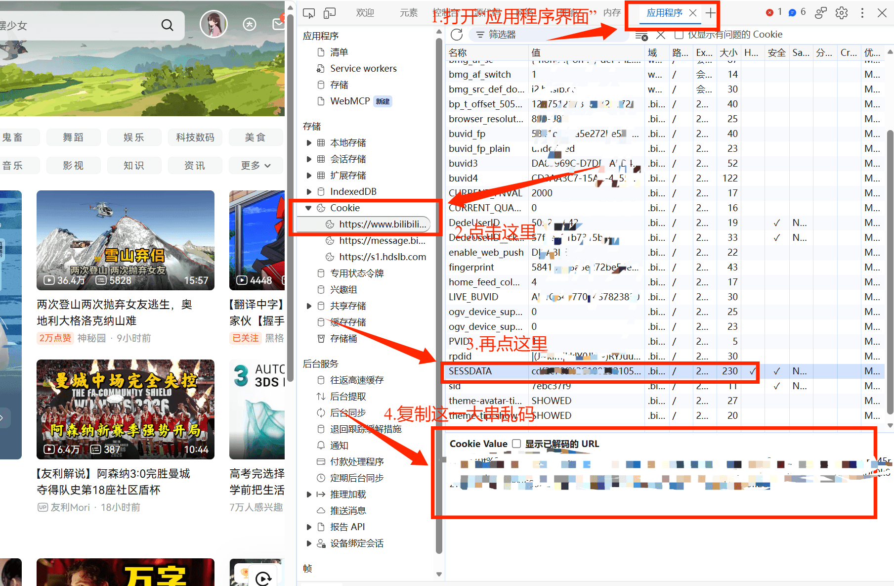
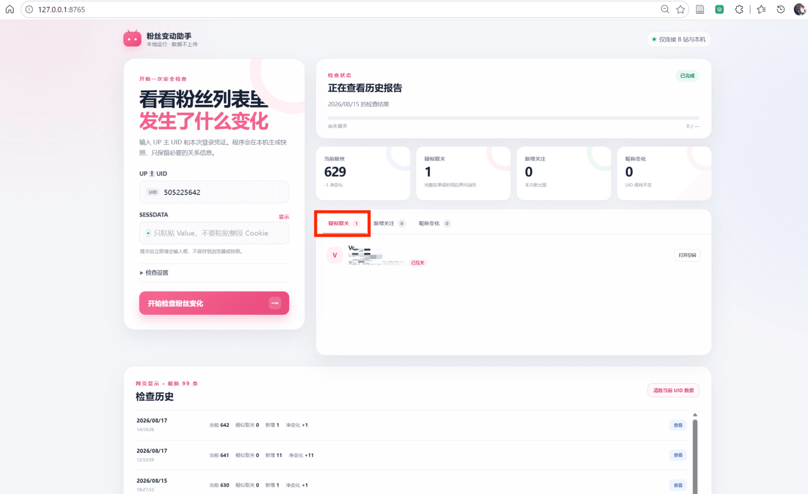
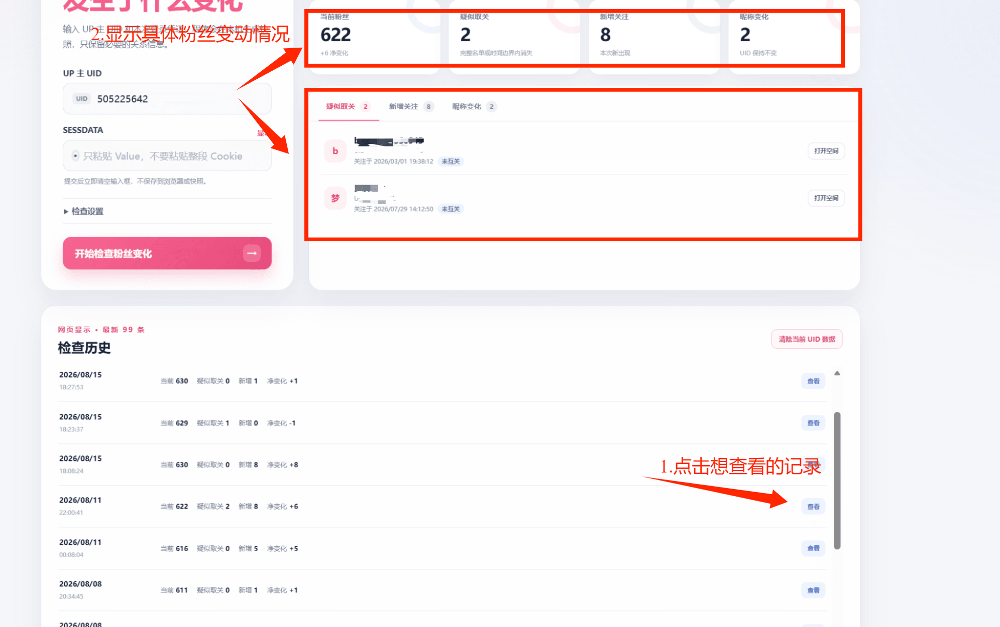

# Bili Follower Tracker

**B站粉丝变动助手**

作为一个b站小up，在看到粉丝数停滞不前还偶尔下跌时，总是会难受地不行，不停下滑翻找粉丝列表，想看看到底是谁取关了啊啊啊————但毕竟肉眼凡胎，不可能记住所有的粉丝以及一大串uid，于是便有了这个小程序，可以帮助你查看是谁取关了自己（另外，还要叠甲一下，关注与取关当然是每个人的权力了，不再喜欢或者觉得做的东西没意思被打扰了也是理所应当取关的，本工具只是用于帮助up主进行粉丝管理和分析，不强迫或骚扰取关的用户强行关注~）

这个小工具会定期保存你的粉丝名单，并比较前后两次记录，帮助你找出：

- 哪些账号疑似取关；
- 哪些账号刚刚关注；
- 哪些粉丝修改了昵称；
- 粉丝的关注时间和检查时的互关状态。

程序在你自己的电脑上运行，数据也保存在程序文件夹里。它不是B站官方工具，因为是通过对比两次保存的粉丝名单之间的差异，因此开始使用之前发生的取关无法找回。

## 主要功能

- 简单的网页界面，不需要输入命令；
- Windows 便携版，无需安装 Python(目前只支持windows)；
- 只需输入 SESSDATA，自动识别当前账号的 UID、昵称和头像；
- 第一次检查建立基线，第二次开始显示粉丝变化；
- 显示两次检查之间的粉丝中疑似取关、新增关注、昵称变化、关注时间和互关状态；
- 点击结果可以打开对应的B站个人空间；
- 检查过程中可以随时中止，中止后不会保存本次结果；
- 网页最多显示最新99份变化报告，本地快照和报告会继续保存；
- 支持清除当前 UID 的全部本地记录；
- 粉丝超过1000时，会检查关注时间边界，只报告能够安全比较的部分。

## 平台支持

当前仅提供并测试了 Windows x64 便携版。macOS 和 Linux 暂无可直接运行的发布包；源码理论上可以自行配置运行，但不属于当前正式支持范围。

## 下载 Windows 便携版

1. 打开仓库的 [Releases 页面](../../releases/latest)。
2. 下载最新的 `BiliFollowerTracker-版本号-windows-x64.zip`。
3. 把 ZIP **完整解压**到一个普通文件夹。
4. 双击 `BiliFollowerTracker.exe`。

不需要安装 Python，也不需要运行安装程序。请不要直接在压缩包里启动，更不要只把 EXE 单独拎走，需要配合 `_internal` 文件夹使用。

当前便携版没有代码签名，Windows 可能显示 SmartScreen 提示。请确认文件来自本仓库的正式 Release，再根据系统提示选择“更多信息 → 仍要运行”。

## 第一次使用

1. 运行 `BiliFollowerTracker.exe`。
2. 程序会打开一个终端窗口，并自动在浏览器中打开操作页面。
3. 输入自己账号的 `SESSDATA`。
4. 点击“登录并检查粉丝变化”。
5. 登录验证成功后，程序会自动识别并显示你的 UID、昵称和头像，然后开始检查。

第一次检查只负责建立基线，不会出现取关记录。第二次以及之后的检查，才会与上一次可比较快照进行对比。

关闭程序的终端窗口即可停止运行。如果浏览器没有自动打开，可以手动访问：

```text
http://127.0.0.1:8765/
```

## 如何获取 SESSDATA

以下步骤适用于 Edge，其他 Chromium 浏览器也大同小异，以下是以edge浏览器为例的说明：

1. 在浏览器中登录B站。
2. 按 `F12` 打开开发者工具。
3. 找到“应用”或 `Application` 页签。如果没有看到，可以在顶部的 `>>` 菜单中寻找。
4. 在左侧打开“存储 / Storage → Cookies”。
5. 选择 `https://www.bilibili.com`。
6. 在 Cookie 列表中找到名称为 `SESSDATA` 的一行。
7. 只复制这一行的 `Value`，粘贴到程序的 SESSDATA 输入框。

只需要复制 Value，不要把整段 Cookie 全家桶一起搬过来。



### SESSDATA 安全提醒

`SESSDATA` 相当于账号的登录凭证，请认真对待：

- 不要发送给其他人；
- 不要截图公开；
- 不要上传到 GitHub；
- 不要写进聊天记录、文档或代码；

程序只在本次检查过程中把 SESSDATA 保存在内存里，提交后会清空输入框，不会写入快照、报告或浏览器本地存储。它只会发送给B站，用于验证登录、读取当前账号信息和请求粉丝名单，不会发送到其他服务。

## 怎么看检查结果

### 疑似取关

表示这个 UID 在上一次可比较记录中存在，但本次已经消失。

这里使用“疑似”，是因为账号注销、封禁或B站清理关系也可能造成同样结果。



### 新增关注

表示本次出现了上一次没有的 UID。

### 昵称变化

UID 没变，但昵称发生了变化。程序以 UID 识别人，因此改名不会被误认成一个新粉丝。

### 关注时间和互关状态

这些信息来自B站接口在检查当时返回的数据。互关后，关系时间有可能刷新，因此“关注时间”不保证永远等于第一次关注的准确时刻。

### 检查历史

这里可以查看每次进行检查的时间，粉丝数变动。点击右侧的查看按钮，上面的“疑似取关”“新增关注”“昵称变化”页面也会变成当前查看的记录，可以看到具体粉丝变化的名单



## 粉丝超过1000时会怎样

B站接口似乎只能获取到最新关注的前1000位粉丝(由于up现在也没有1000粉丝，所以不确定是不是真的……)，粉丝超过1000时，程序会获取最新快照的最早关注时间作为边界时间，只比较边界时间内关注的粉丝的变化情况，在范围外则没办法比较了。具体操作如下：

1. 读取当前可见的前1000条记录；
2. 检查每条记录是否有有效的关注时间；
3. 检查B站原始返回顺序是否确实按照关注时间排列；
4. 只比较严格位于时间边界内、不会因为名单滚动而被挤出去的部分。

位于第1000名边界之外，或者关注时间正好等于边界的记录，不会被计入结果。这样可能少报，但能尽量避免把“只是被新粉丝挤出可见范围”误判成取关。

## 数据保存在哪里

所有快照和报告都保存在程序目录下：

```text
.local-data\bilibili\你的UID\
```

网页中的“检查历史”只显示最新99份变化报告，但更早的快照和报告仍会保留在上述目录中，不会自动删除。如果长期使用，文件数量会逐渐增加；需要清理时，可以使用网页里的“清除当前 UID 数据”，或在关闭程序后手动删除对应目录。

程序不会把粉丝数据保存到系统目录。你可以在网页中清除当前 UID 的数据，也可以在关闭程序后删除 `.local-data` 文件夹。

想卸载时，关闭程序并删除整个便携版文件夹即可。程序不会安装 Python、不会创建系统服务，也不会在卸载后留下一套复杂家产。

## 常见问题

### 为什么第一次检查没有变化记录？

因为还没有旧名单可以比较。第一次建立基线，第二次才有前后对照。

### 为什么显示“未建立基线”？

说明当前 UID 还没有成功保存过可比较快照。完成一次通过校验的检查后，状态就会变成“已建立基线”。

### 为什么输入框中的 SESSDATA 提交后消失了？

这是有意设计的，避免登录凭证长时间留在页面中。下次检查需要重新粘贴。

### 为什么程序打开了一个终端窗口？

网页界面由电脑上的本地服务提供，终端窗口就是它的运行窗口。关掉它，程序也会停止。

### 浏览器没有自动打开怎么办？

确认程序终端窗口仍在运行，然后访问 `http://127.0.0.1:8765/`。

### SESSDATA 以前能用，现在报登录错误怎么办？

登录状态可能已经过期。重新登录B站，再按照上面的步骤复制新的 `SESSDATA`。

### 出现接口拦截或 `code=-352` 怎么办？

先停止检查，过一段时间再试。不要连续疯狂点击。

### 这个工具会自动在后台监控吗？

不会。当前版本需要你手动打开并检查，适合偶尔记录粉丝变化，也能避免过于频繁地请求B站接口。

### 其他问题

遇事不决，先尝试刷新页面，有时候可能就是单纯网络原因。或者卡了！！
还有就是，尽量不要打开多个此程序，好像也会出问题

## 最后说明

本项目仅供个人记录和学习使用，不是B站官方产品。B站网页接口可能随时调整；如果接口行为变化，程序可能需要更新。

本项目由codex辅助（其实几乎全是它写的，本人啥也没干）完成的，个人能力有限，存在疏漏或不合理之处敬请谅解。如遇bug欢迎提出，会尽量回复的，但不保证有时间和能力解决……

请只检查自己的账号，妥善保管登录凭证，并以合理频率使用。
